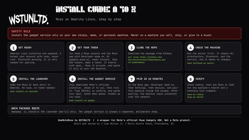
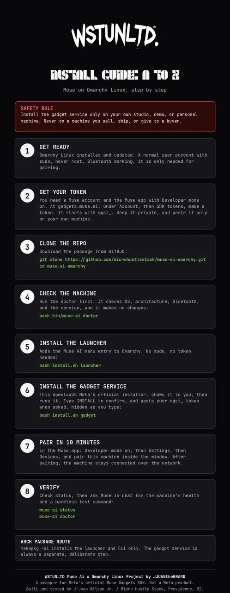

# OmaMetaMuse by WSTUNLTD

**Muse on Omarchy Linux, packaged so anyone can load it the same way we did.**

> **Security notice:** the Muse gadget service grants Muse remote command
> access to the machine it runs on, as the user who installed it, including
> sudo if that user has sudo. Install it only on a machine you own and
> control. Never install it on a machine you sell, ship, or hand over.
> Read [SECURITY.md](SECURITY.md) and [DISCLAIMER.md](DISCLAIMER.md) before
> installing. `muse-ai security` prints both documents in the terminal.

This repo packages the exact setup we proved on October 22, 2026: a
2011 MacBook Air running Omarchy Linux, turned into a Muse connected
machine you can talk to and drive from chat.

It has two parts. Both are included. You can install one or both.

1. **Muse AI launcher.** A menu entry named "Muse AI" in Omarchy's
   launcher. It opens muse.ai as a standalone window, with the official
   blue Muse icon, following Omarchy's own webapp pattern.
2. **Muse Gadget service.** Meta's official Muse Gadgets Linux Device
   SDK, installed the Omarchy way. Once paired, Muse can check the
   machine's health and, only at your direction, run commands and read
   or write files on that machine from your Muse chat. Programs on the
   machine can also push messages into your chats with
   `musegadget send-user-msg`.

This repo does not contain Meta's SDK code and does not contain a local
model. Muse stays in the cloud. This repo is a wrapper: it checks your
machine, downloads the official installer from Meta's official repo at
install time, and adds the Omarchy launcher, checks, and guardrails
around it.

Upstream: https://github.com/facebookincubator/muse-gadget-sdk
Upstream license: Apache 2.0. This wrapper: MIT, see LICENSE.

## Install at a glance



The full step by step is in the Quick start below. The portrait
version of this guide is at the bottom of this page.

## About

OmaMetaMuse by WSTUNLTD is a
community packaging project from Providence, RI. It exists for one
reason: giving old hardware a second life on Omarchy Linux, with Muse
as the voice and hands for the machine.

It is built for people who refurbish and reuse machines, for the
WSTUNLTD youth studio and demo setups that run this stack, and for
anyone who wants the same Muse on Omarchy setup we proved on
October 22, 2026, without piecing it together from scratch.

It is not a Meta product, not a fork of the SDK, and not a local
model. Muse stays in the cloud. Meta's official installer is fetched
from Meta at install time, and this wrapper adds the Omarchy
launcher, the preflight checks, and the guardrails around it. The
companion project, WSTUNLTD™ Second Brain Omarchy by JJUANtheBRAND™,
covers the local model and vault side on the same machine.

## Read this first: the safety rule

The gadget service grants cloud command access to the machine it runs
on, as the user who installed it, including sudo if that user has sudo.

Install it only on your own studio, demo, or personal machine.
Never install it on a machine you sell, ship, or hand to someone else
as an appliance. That is the rule this project was built under, and it
is printed again by the installer before anything runs.

Read [SECURITY.md](SECURITY.md) for the token rules and the full risk
model, and [DISCLAIMER.md](DISCLAIMER.md) for the warranty and
liability terms. `muse-ai security` prints both.

## Tested hardware

First verified install, October 22, 2026:

| Item | Value |
|---|---|
| Machine | MacBook Air 11-inch, Mid 2011 |
| CPU | Intel Core i5-2467M, x86_64 |
| RAM | 4 GB |
| Storage | 128 GB SSD, about 86 GB free after install |
| OS | Omarchy 4.0.6-1, kernel 7.2.8-9-omarchy |
| Desktop | Hyprland 0.56.2, Wayland |
| Bluetooth | Built in controller, powered on, pairable |
| T2 chip | None, so no T2 workarounds needed |
| Result | Installed, paired, health check passed, command test passed |

4 GB is enough for this project. The gadget service is a lightweight
Python service, not a local model. For local models, see the companion
project: WSTUNLTD™ Second Brain Omarchy by JJUANtheBRAND™ at
https://github.com/microhustlestack/second-brain-omarchy

## What you need

1. Omarchy Linux installed and updated. Other Arch based systems will
   likely work, the upstream installer prints an "untested, Arch-based"
   warning on Omarchy. That warning is expected.
2. A normal user account with sudo. Do not run the installer as root.
   The upstream installer refuses root.
3. Bluetooth working, for pairing only. Check: `ls /sys/class/bluetooth`
   should list a controller, and `bluetoothctl show` should say
   Powered: yes. After pairing, the machine stays connected over the
   network. Bluetooth is not needed day to day.
4. A Muse account, and the Muse app on your phone with Developer mode
   on, then Settings, then Devices, ready for pairing.
5. An SDK token from gadgets.muse.ai, under Account, then SDK tokens.
   It starts with `mgst_`. Keep it private. Never paste it into a repo,
   an issue, or a chat. You paste it only on your own machine, at
   install time.

## Quick start

```bash
git clone https://github.com/microhustlestack/OmaMetaMuse.git
cd OmaMetaMuse

# 1. Check the machine first. No changes are made.
bash bin/muse-ai doctor

# 2. Install the CLI and the Muse AI menu launcher. No sudo, no token.
bash install.sh launcher

# 3. Install the gadget service. Read the security notice first.
#    This downloads Meta's official installer, checks it, prints its
#    SHA-256, saves a review copy, and then runs it.
bash install.sh gadget
# Type INSTALL at the notice. Meta's installer then prompts for your
# mgst_ token with echo hidden.

# 4. Pair inside the 10 minute window, in the Muse app:
#    Developer mode on, Settings, Devices, then pair this machine.

# 5. Verify. install.sh puts muse-ai in ~/.local/bin.
muse-ai status
muse-ai doctor
```

If your shell cannot find `muse-ai`, add the user bin directory:

```bash
export PATH="$HOME/.local/bin:$PATH"
```

Then, from your Muse chat, ask Muse to check the machine. A healthy
paired machine reports its temperature, free memory, free disk, uptime,
and load, and a harmless test command returns your username, hostname,
`x86_64` or `aarch64`, and `active` for the musegadget service.

No terminal needs to stay open after install. The service runs in the
background. The machine only needs to be awake and on Wi-Fi.

## Install routes

### User install, no packaging needed

`bash install.sh` with no argument installs the CLI and the launcher into
`~/.local`, then prints the gadget step without running it.
`bash install.sh gadget` runs the gadget step. `bash install.sh all` does
the launcher, CLI, and gadget in one pass. `bash install.sh plugin`
installs the companion bar plugin. `bash install.sh uninstall` removes the
user launcher, icons, CLI, and plugin; the gadget service has its own
removal command, `muse-ai uninstall-gadget`.

### Arch package, AUR style

```bash
makepkg -si
```

The PKGBUILD installs the CLI to `/usr/bin/muse-ai`, the launcher to
`/usr/share/applications/`, the bar plugin source, and the docs. It does
not install the gadget service and it does not ask for a token. That step
is always a separate, deliberate run of `muse-ai install-gadget`, for the
safety reason above.

## Companion bar plugin

The `plugin/` folder holds a small Omarchy 4 (Quattro) shell plugin: a
bar widget that shows whether this machine is linked to Muse. It
watches `musegadget.service` and shows a status dot next to the Muse
icon in the bar, green while the service is active, red while it is
not. Clicking it opens Muse through Omarchy's webapp launcher. Its plugin
ID is `io.github.microhustlestack.muse`.

Install the bundled copy from this repository:

```bash
muse-ai plugin-install
```

That copies `plugin/` into
`~/.config/omarchy/plugins/io.github.microhustlestack.muse/`, rescans the
shell, and enables the widget. If you prefer to do it by hand:

```bash
mkdir -p ~/.config/omarchy/plugins/io.github.microhustlestack.muse
cp -r plugin/. ~/.config/omarchy/plugins/io.github.microhustlestack.muse/
omarchy-shell shell rescanPlugins
omarchy plugin enable io.github.microhustlestack.muse
```

Remove it with `muse-ai plugin-remove`. Settings, IPC commands, and
manual removal instructions are in [plugin/README.md](plugin/README.md).
The widget only reads `systemctl is-active` and runs the launch command
you configure; it does not install or control the gadget service.

## The CLI

```text
muse-ai doctor           Check OS, arch, Bluetooth, service, launcher, icons
muse-ai status           Short status: service, launcher, CLI, icon
muse-ai open             Open Muse (muse.ai) as a webapp
muse-ai launcher         Install or reinstall the Muse AI menu entry
muse-ai install-gadget   Read the security notice, then run Meta's installer
muse-ai uninstall-gadget Remove the gadget service
                         (--purge also deletes device identity and pairing)
muse-ai pair-help        Print the pairing steps in order
muse-ai plugin-install   Install the bundled Omarchy bar plugin
muse-ai plugin-remove    Remove the Omarchy bar plugin
muse-ai security         Print the security notice and disclaimer
muse-ai version          Print the CLI version
muse-ai uninstall        Remove the launcher, icons, CLI, and plugin
```

`muse-ai install-gadget` requires you to type `INSTALL` after the notice.
For automation, read [SECURITY.md](SECURITY.md) and
[DISCLAIMER.md](DISCLAIMER.md) first, then pass `--accept-disclaimer`.
`--yes`, `--no-pair`, `--run-as`, and `--proxy` are forwarded to Meta's
installer. `MUSE_SDK_TOKEN` is an explicit opt-in that forwards the token
as an argument and prints a warning; the default path lets Meta's installer
prompt with echo hidden, so the token never appears in `ps`.

## How the launcher works

Omarchy already ships a webapp pattern: a `.desktop` file whose Exec
line is `omarchy-launch-webapp https://example.com/`. This project
follows that pattern exactly:

- File: `~/.local/share/applications/Muse.desktop`
- Name: `Muse AI`
- Exec: `omarchy-launch-webapp https://muse.ai/`
- Icon: `muse-ai`, PNG renders at 256, 128, 64, 48, and 32 px, made
  at install time with `rsvg-convert` from the official Muse squiggle
  SVG at https://muse.ai/images/favicon/app-squiggle.svg, downloaded
  directly by your machine. If `rsvg-convert` is missing, the SVG is
  installed at `~/.local/share/icons/hicolor/scalable/apps/muse-ai.svg`.

## Troubleshooting

- **Token rejected.** You pasted a placeholder, an old token, or an
  API key from somewhere else. Make a fresh SDK token at
  gadgets.muse.ai, Account, SDK tokens, and rerun. This was the only
  failure in our first attempt on the 2011 Air.
- **Ran as root.** Leave the root shell and rerun as your normal user.
- **No Bluetooth controller.** Check `systemctl status bluetooth`,
  try `bluetoothctl power on`, and check firmware. A USB Bluetooth
  dongle is the fallback on very old hardware.
- **Pairing window missed.** Run `sudo musegadget pair` and pair right away.
- **Icon shows black or invisible.** Reinstall the launcher: `muse-ai
  launcher`. It re-renders the blue icon and refreshes the icon cache.
  If it still looks wrong, run
  `gtk-update-icon-cache -f -t ~/.local/share/icons/hicolor` and reopen
  the launcher. The working icon on our test Air is the blue render,
  verified on device.
- **Service not active.** `systemctl status musegadget --no-pager`
  and `journalctl -u musegadget -f` on the machine.

Full notes: [docs/TROUBLESHOOTING.md](docs/TROUBLESHOOTING.md)
Test log: [docs/TESTED-HARDWARE.md](docs/TESTED-HARDWARE.md)
Security: [SECURITY.md](SECURITY.md)
Disclaimer: [DISCLAIMER.md](DISCLAIMER.md)

## What this repo is not

- Not a local Muse model. There is no model download here.
- Not a fork of Meta's SDK. The official installer is fetched from the
  official repo at install time, so you always get Meta's current code,
  from Meta.
- Not for sold or shipped machines. Studio and personal machines only.
- Not affiliated with or endorsed by Meta. Muse and Omarchy are their
  owners' projects and marks. This is a community packaging project by
  JJUANtheBRAND™ under WSTUNLTD™.

## Credits

Built and tested by J'Juan Wilson Jr. / JJUANtheBRAND™ / Micro Hustle
Stack, Providence, RI. Part of the WSTUNLTD™ work of giving old hardware
a second life on Omarchy Linux: the same 2011 Air also runs the
[WSTUNLTD™ Second Brain Omarchy package](https://github.com/microhustlestack/second-brain-omarchy)
end to end.

## Install guide, portrait version


